# playlist-porter

A small desktop app (Rust + egui) that lets you:

- **export your own playlists** (ones you own or collaborate on) to CSV or JSON, and
- **recreate them as private YouTube playlists**, with a per-track match report.

It moves playlist *metadata* only. It never downloads, streams or plays audio.
Personal, non-commercial use only. GUI only: running the binary opens the window.

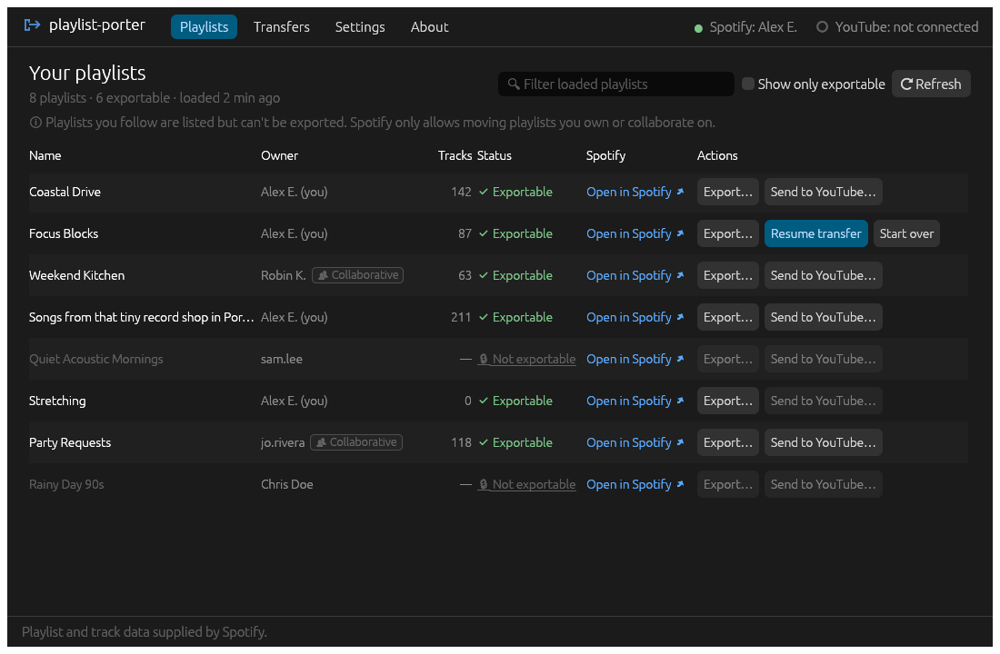

> playlist-porter is an independent project. It is not affiliated with,
> endorsed by, or sponsored by Spotify or Google/YouTube. Track metadata is
> supplied by Spotify. This tool exports only playlist metadata from your own
> account through official APIs and never downloads audio. You are solely
> responsible for how you use the exported data and for following Spotify's
> and YouTube's terms and copyright law where you live. The authors are not
> liable for any misuse, including downloading or sharing copyrighted
> material.

Contents: [Setup](#setup) · [Usage](#usage) · [Limitations](#limitations) ·
[Privacy](#privacy) · [Development](#development) · [Disclaimer](#disclaimer)

---

## Setup

playlist-porter uses **your own** Spotify and Google developer apps. You create
them once, then paste their IDs into the Setup screen.

### 1. Build

You need a recent stable Rust toolchain (1.95 or newer).

```bash
cargo build --release
```

The binary is `target/release/playlist-porter`.

On Linux you also need:

- **A Secret Service keyring** (GNOME Keyring or KWallet), running and
  unlocked. Sign-in tokens are stored *only* in the OS keyring. If none is
  available, the app shows an error and never falls back to a plain file.
- **xdg-desktop-portal** (installed with GNOME/KDE) for the native Save dialogs.

macOS and Windows use the Keychain / Credential Manager.

### 2. Create the Spotify developer app

1. Go to the [Spotify Developer Dashboard](https://developer.spotify.com/dashboard)
   and create an app.
   - **Don't use "Spotify" in the app name** (Spotify's developer terms forbid it).
   - Choose **Web API**.
   - Add the redirect URI **`http://127.0.0.1:8888/callback`** exactly. Use
     the IP address, not `localhost`. (If you change the port in Settings,
     register the matching URI.)
2. The app owner needs an **active Spotify Premium** subscription. Apps in
   Development Mode stop working if it lapses.
3. Under **User Management**, add every person who will use the app (name and
   Spotify account email). Development Mode allows **at most 5 users**.
4. Copy the **Client ID**. No client secret is needed: sign-in uses
   Authorization Code with PKCE in your system browser.

If Spotify refuses access after sign-in (HTTP 403), the account isn't in the
app's user list or the owner's Premium has lapsed. The app shows Spotify's
message and links back here.

### 3. Create the Google / YouTube app (only for "Send to YouTube")

1. In the [Google Cloud console](https://console.cloud.google.com/), create a
   project and enable **YouTube Data API v3**.
2. Configure the **OAuth consent screen**: External, keep it in **Testing**
   mode, and add yourself (and anyone else who will use it) as a **test user**.
   The only scope the app requests is `https://www.googleapis.com/auth/youtube`.
3. Create an **OAuth client ID** of type **Desktop app**. Copy the client ID
   and client secret. Desktop clients accept the app's loopback redirect
   (`http://127.0.0.1:<port>/callback`).

### 4. Enter the IDs

Start the app. The **Setup** screen asks for the Spotify client ID and,
optionally, the Google client ID and secret, and shows the redirect URI to
register (with a Copy button). Save writes
`~/.config/playlist-porter/config.toml`.

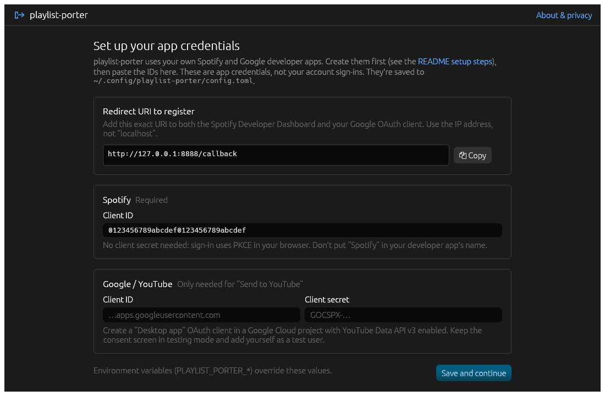

Alternatively, copy [`config.example.toml`](config.example.toml) to that path,
or set environment variables, which override the file:

| Variable | Meaning |
|---|---|
| `PLAYLIST_PORTER_SPOTIFY_CLIENT_ID` | Spotify client ID |
| `PLAYLIST_PORTER_GOOGLE_CLIENT_ID` | Google OAuth client ID |
| `PLAYLIST_PORTER_GOOGLE_CLIENT_SECRET` | Google OAuth client secret |
| `PLAYLIST_PORTER_REDIRECT_PORT` | Loopback port (default `8888`) |

These are app credentials, not account sign-ins. Never commit `config.toml`
or `.env` (both are in `.gitignore`).

---

## Usage

### Sign in to Spotify

Click **Connect Spotify**. Your system browser opens Spotify's consent page;
the app waits on `127.0.0.1:<port>` for up to 5 minutes (with a Cancel button,
and the address shown in case the browser didn't open). The app asks only for
`playlist-read-private` and `playlist-read-collaborative`.

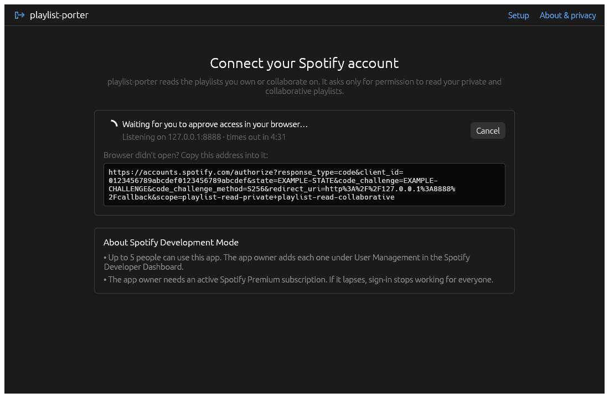

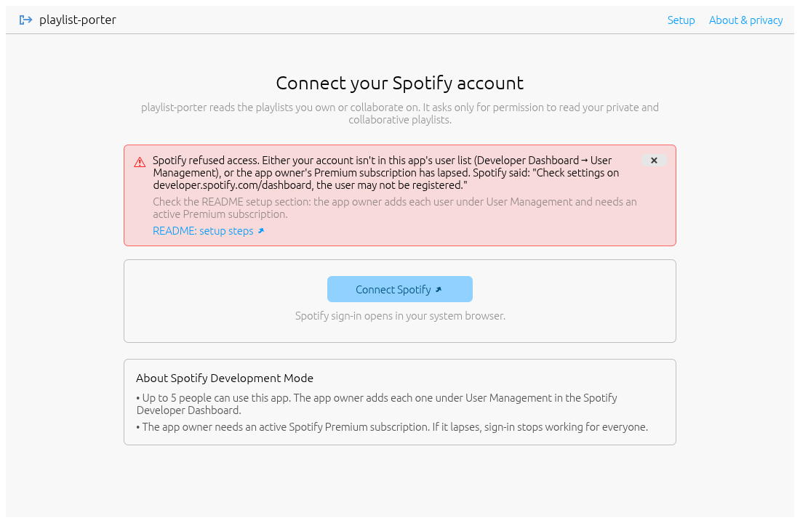

### Your playlists

The main screen lists every playlist in your library. Ones you **own** or that
are **collaborative** are *Exportable*; playlists you only follow are listed as
*Not exportable* (hover for why) and their actions are disabled. Filter the
loaded list, show only exportable playlists, or **Refresh** to re-fetch.
Each row links to the playlist on Spotify.

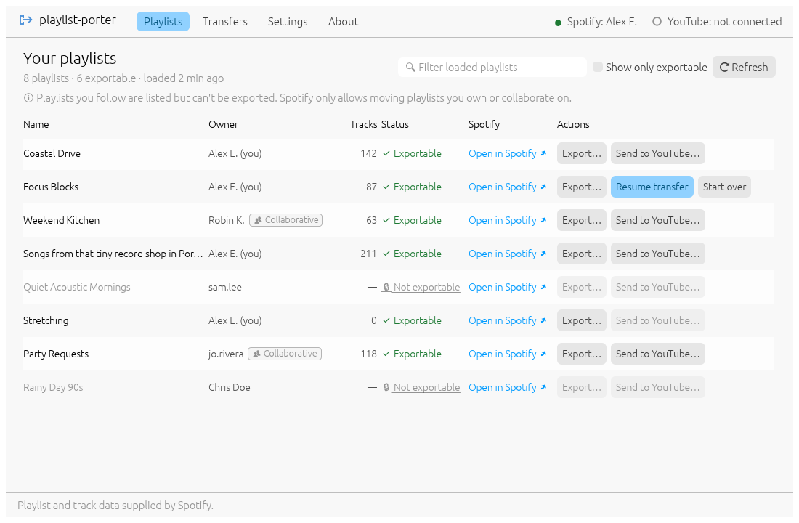

Click a playlist name to see its tracks. Local files, podcast episodes and
unavailable tracks are marked **skipped**; they're left out of exports and
transfers.

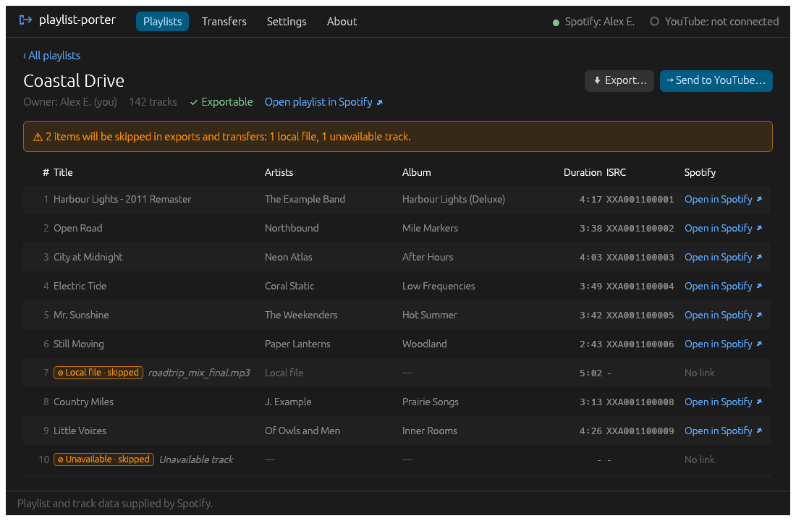

### Export to CSV or JSON

**Export…** asks for a format and a location (with a native Save dialog). If
the file exists you're asked before it's replaced. When it's done, a toast
offers **Show in folder**.

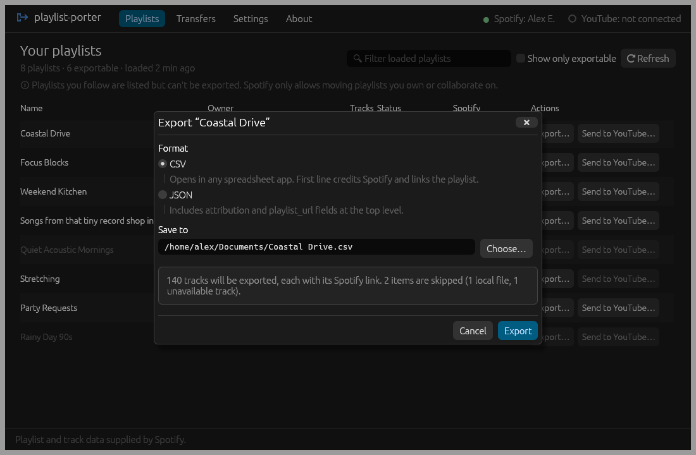

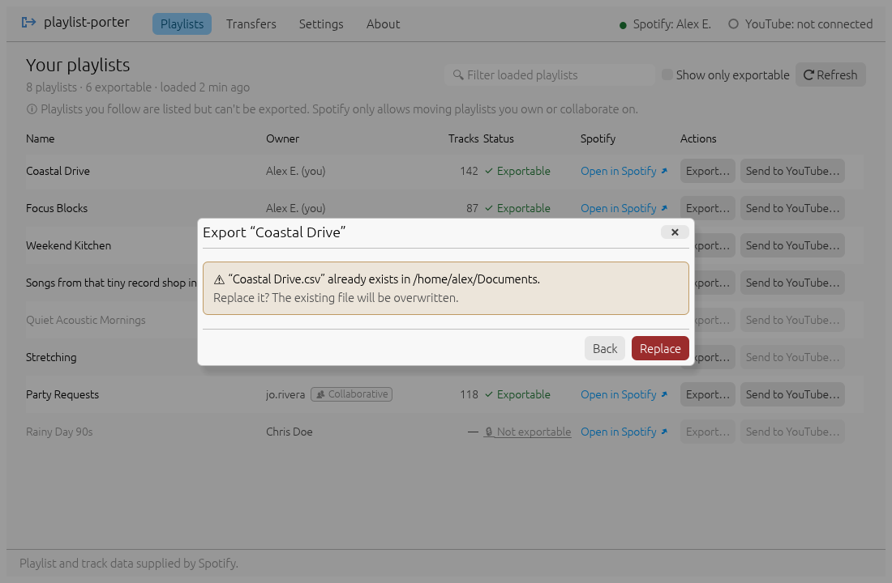

- **CSV**: the first line is a `#` comment crediting Spotify with the playlist
  URL, then a header row; every row has a `spotify_url`.
- **JSON**: top-level `attribution` and `playlist_url`, plus `spotify_url` per
  track and counts of skipped items.

### Send to YouTube

1. **Notice.** Before your first Google sign-in the app explains the YouTube
   terms, what it accesses and what it stores (the same text as
   [Privacy → YouTube](#youtube) below).

   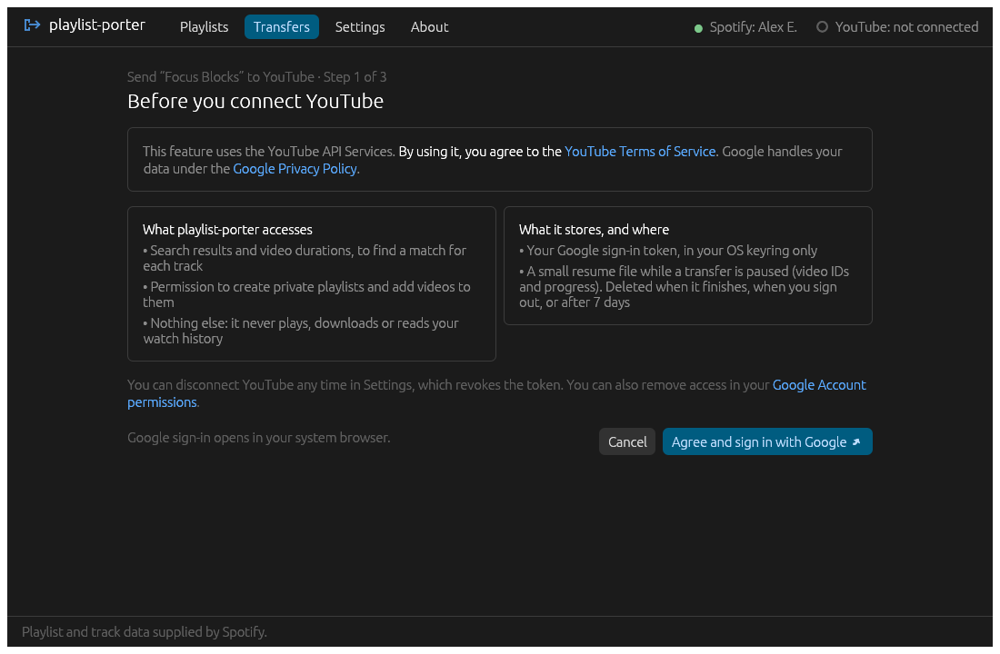

2. **Google sign-in** in your system browser (PKCE, loopback redirect).
3. **Confirmation.** Nothing is created until you confirm: playlist name,
   track count, estimated quota and days needed, the quota reset time in your
   time zone, and the playlist description. The playlist is **private**.

   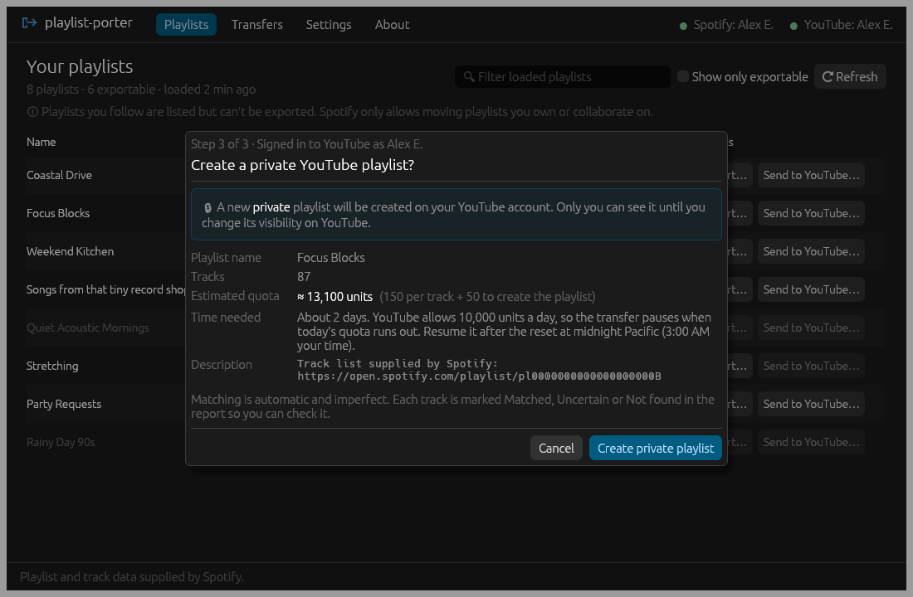

4. **Progress.** Track and quota progress bars, the track being searched, and
   **Cancel** (stops after the current request and saves your place). The match
   report fills in live; filter it by status and **Save report…** as CSV or
   JSON (with attribution and both links per track).

   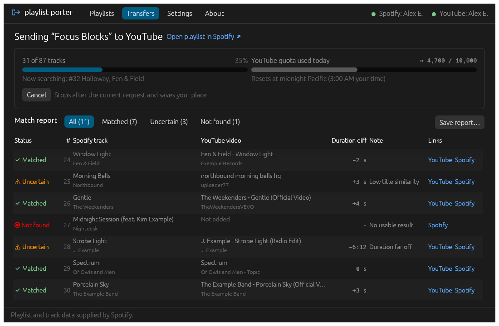

   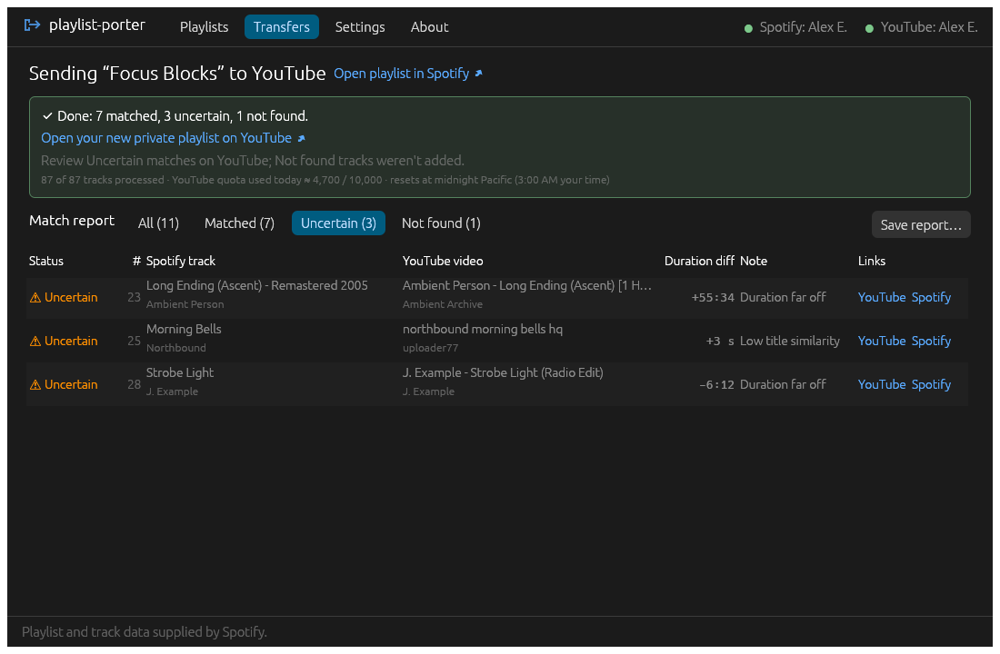

Each track is **Matched** (strong title/artist match within ±5 s of the
Spotify duration), **Uncertain** (added, but check it) or **Not found** (not
added). Matching is deterministic string and duration logic; nothing is sent
to any AI service.

### Settings and About

**Settings** shows both accounts and offers **Disconnect Spotify**,
**Disconnect YouTube** and **Sign out of everything**, the redirect port,
theme (follow system / light / dark) and **Edit setup…**. After a disconnect a
panel lists exactly what was deleted.

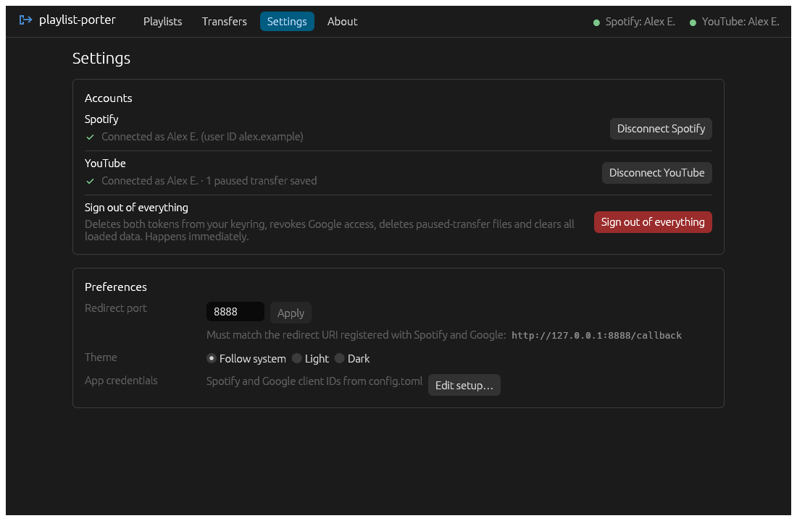

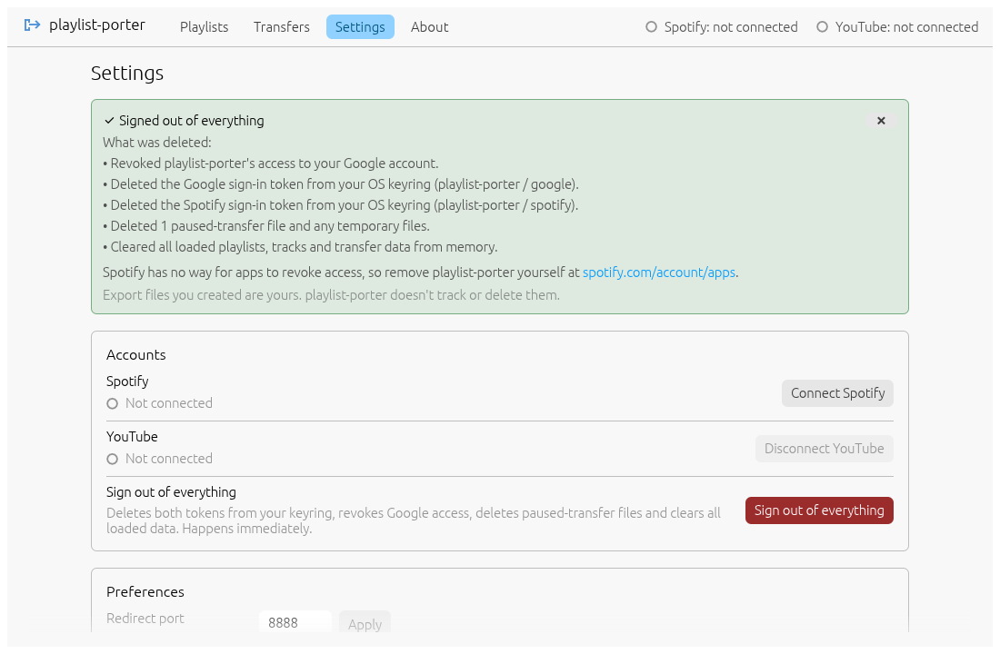

**About** shows the disclaimer, what's stored where, and the revoke and policy
links.

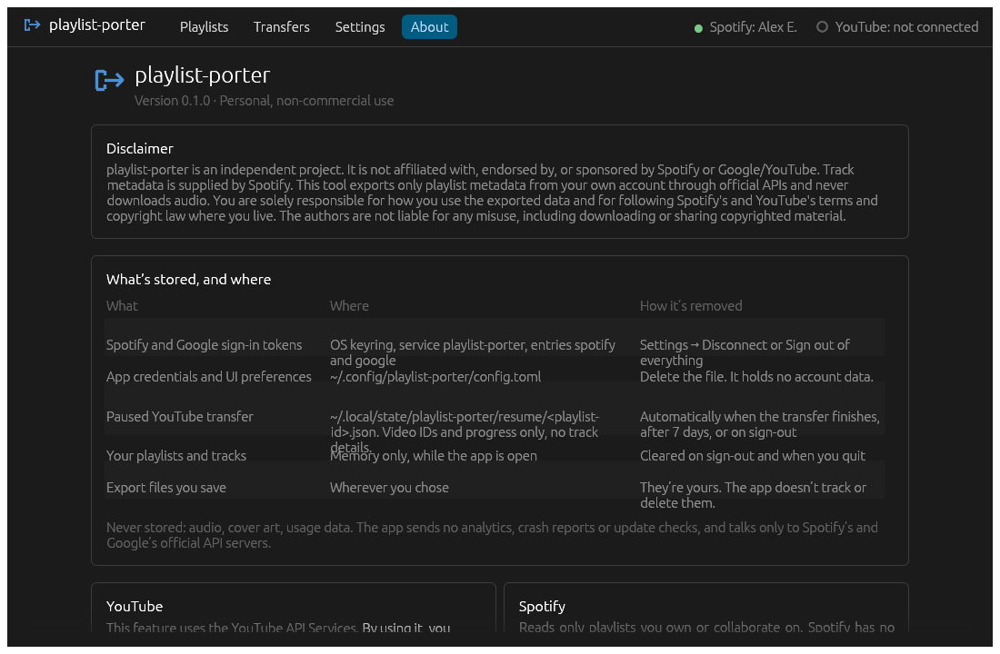

---

## Limitations

- **Your own playlists only.** Spotify lets apps move only playlists you own
  or collaborate on. Followed playlists appear in the list but can't be
  exported or sent, and there's no way to process a playlist by URL.
- **Spotify Development Mode**: at most **5 users**, added by hand in the
  dashboard, and the app owner needs an active **Premium** subscription.
- **YouTube quota**: the default quota is 10,000 units a day, and each track
  costs about 150 (search 100 + video details 1 + add to playlist 50), plus 50
  to create the playlist. That's roughly **65 tracks a day**. When today's
  quota runs out the transfer pauses; the quota resets at **midnight Pacific
  time** (the app shows the time in your zone).
- **Resume**: progress is saved after each track. A playlist with saved
  progress shows **Resume transfer** (continue into the same YouTube playlist)
  and **Start over** (discard the saved place; a new playlist is created). On
  resume the playlist is re-fetched from Spotify. Saved progress expires after
  7 days. If the Spotify playlist changed a lot in between, results may be off;
  use Start over.
- **Matching is imperfect.** Check Uncertain tracks; Not found tracks aren't
  added. Live, cover and remix videos are skipped unless the Spotify title says
  so too.
- **Skipped items**: local files, podcast episodes and unavailable tracks are
  never exported or transferred.
- The quota used today is an estimate kept by this app while it runs; usage
  from other apps on the same Google project isn't visible.

---

## Privacy

### What's stored, and where

| What | Where | How it's removed |
|---|---|---|
| Spotify and Google sign-in tokens | OS keyring only: service `playlist-porter`, entries `spotify` and `google` | Settings → Disconnect / Sign out of everything |
| App credentials (client IDs, Google client secret) and UI preferences (theme, last export format/folder) | `~/.config/playlist-porter/config.toml` | Delete the file. It holds no account data. |
| Paused YouTube transfer | `$XDG_STATE_HOME/playlist-porter/resume/<playlist-id>.json` (usually `~/.local/state/…`): Spotify and YouTube playlist IDs, next track index, and YouTube video ID + status per track. No track details. | Automatically when the transfer finishes, after 7 days, or on sign-out |
| Your playlists and tracks | Memory only, while the app is open | Cleared on sign-out and when you quit |
| Export files and reports you save | Wherever you chose | They're yours. The app doesn't track or delete them. |

Never stored: audio, cover art, usage data. There are no analytics, crash
reports, telemetry or update checks. The app contacts only
`accounts.spotify.com`, `api.spotify.com`, `accounts.google.com` (in your
browser), `oauth2.googleapis.com` and `www.googleapis.com`.

### Signing out

**Settings → Sign out of everything** runs immediately. It deletes both
keyring entries, **revokes the Google token** with Google, deletes all resume
and temporary files, and clears all loaded data. **Disconnect Spotify** and
**Disconnect YouTube** do the same for one service.

- Spotify has no endpoint for apps to revoke access. Remove playlist-porter
  yourself at <https://www.spotify.com/account/apps>.
- You can also remove Google access at
  <https://security.google.com/settings/security/permissions>.

### YouTube

The "Send to YouTube" feature uses the YouTube API Services. **By using it,
you agree to the [YouTube Terms of Service](https://www.youtube.com/t/terms).**
Google handles your data under the
[Google Privacy Policy](http://www.google.com/policies/privacy).

What playlist-porter accesses:

- Search results and video durations, to find a match for each track
- Permission to create private playlists and add videos to them
- Nothing else: it never plays, downloads or reads your watch history

What it stores, and where:

- Your Google sign-in token, in your OS keyring only
- A small resume file while a transfer is paused (video IDs and progress),
  deleted when it finishes, when you sign out, or after 7 days

You can disconnect YouTube any time in Settings, which revokes the token. You
can also remove access in your
[Google Account permissions](https://security.google.com/settings/security/permissions).

### Attribution

Playlist and track data is supplied by Spotify. The app says so in a footer on
every screen that shows Spotify data, links every playlist and track to
Spotify, and credits Spotify in every export, report and YouTube playlist
description ("Track list supplied by Spotify: <playlist URL>").

---

## Development

```bash
cargo fmt
cargo clippy --all-targets -- -D warnings
cargo test
```

All tests run offline, without a GUI or network (fixtures in
`tests/fixtures/`, a fake YouTube API for the transfer loop).

Screens are rendered headlessly with fake data by `tests/screens.rs`. To
regenerate the screenshots in this README (uses wgpu; software rendering
works):

```bash
PP_SCREENSHOT_DIR=docs/screenshots PP_SCREENSHOT_SIZE=large cargo test --test screens -- --ignored
```

Without the variables, renders of every screen in both themes at 800×600 go
to `target/screens/`. The original UI mockups are in `docs/mockups/`.

Project rules (API usage, compliance, architecture) are in
[`CLAUDE.md`](CLAUDE.md).

---

## Disclaimer

> playlist-porter is an independent project. It is not affiliated with,
> endorsed by, or sponsored by Spotify or Google/YouTube. Track metadata is
> supplied by Spotify. This tool exports only playlist metadata from your own
> account through official APIs and never downloads audio. You are solely
> responsible for how you use the exported data and for following Spotify's
> and YouTube's terms and copyright law where you live. The authors are not
> liable for any misuse, including downloading or sharing copyrighted
> material.
